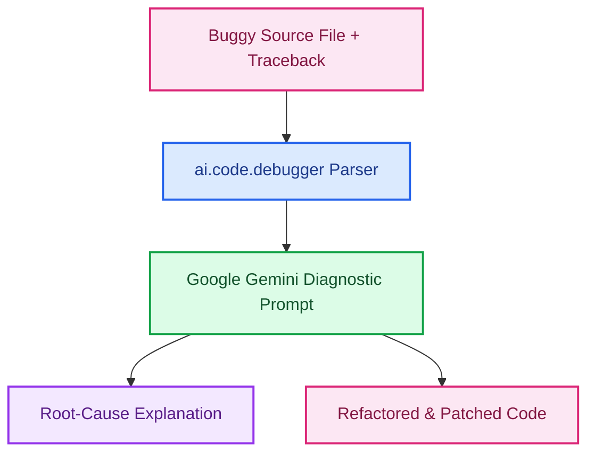

# ai.code.debugger

> **Author & Architect:** [Robina Mirbahar](https://github.com/RobinaMirbahar) ([Google Developer Expert in Cloud & AI](https://developers.google.com/profile/u/106918534005910641104?utm_campaign=deveco_gdemembers&utm_source=deveco) · Google Cloud Champion Innovator · Co-Author of [*AI Engineering*](https://www.amazon.com/dp/B0GWCZWCF4))  
> **Focus:** Fast Python & Google Gemini Code Diagnostics, Bug Explanation & Patch Suggestion Utility

---

## 🎯 Why I Built ai.code.debugger — Lightweight Gemini Static Analyzer (Engineering Purpose & Real-World Value)

### 1. 🔍 Fast, Minimalist Code Diagnostics
I created `ai.code.debugger` as a lightweight, zero-bloat companion for inspecting buggy scripts, understanding stack traces, and generating clean refactored code using the Google Gemini API.

### 2. 📖 Educational Line-by-Line Explanations
Rather than returning an unexplained code block, my prompt architecture outputs a clear breakdown of *what* broke, *why* it broke, and *how* the patch prevents regressions.

### 3. ⚡ Drop-In Extensibility
Designed with a clean Python footprint that integrates into local scripts, notebooks, or CI pre-commit hooks.

---

## 🏗️ System Architecture

---
---

### Official Google Developer Resources
- [Google Gemini API & AI Studio Docs](https://ai.google.dev/gemini-api/docs?utm_campaign=deveco_gdemembers&utm_source=deveco)
